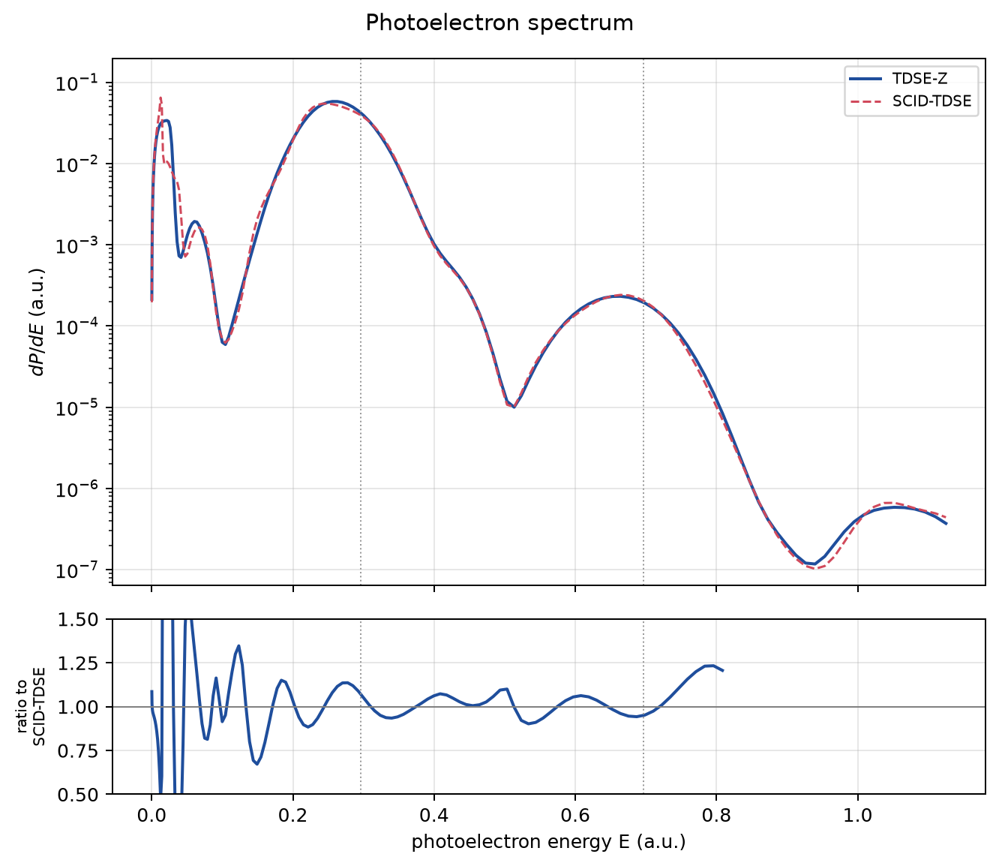

Photoelectron and harmonic spectra
==================================

TDSE-Z writes t-SURFF amplitudes to ``td/<name>_surff.h5`` when ``TSurff = 1``
(see the TDSE-Z t-SURFF documentation). zkit reads them, puts them on a
spherical (``|k|``, θ) grid, and reduces them to energy spectra, angular
distributions and yields. It also reads SCID-TDSE tables, so that the two
codes can be compared one to one.

Reading
-------

.. code-block:: python

   import zkit

   spec = zkit.Run("run01", "quick.inp").surff   # or zkit.read_surff(path)
   spec.momenta, spec.amplitude, spec.pes        # list of k, b(k), |b(k)|^2
   spec.axes, spec.pes_grid                      # grid mode: k axes and |b|^2 on the grid
   spec.attrs["end_term"], spec.attrs["radius"]  # file attributes

``amplitude`` includes the end term when ``SurffEndTerm = 1``, and
``amplitude_flux`` holds the surface flux alone.

Energy spectrum and angular distributions
-----------------------------------------

.. code-block:: python

   import numpy as np
   from zkit.photoelectron import angular_distribution, energy_spectrum, to_spherical

   k = np.linspace(0.01, 1.5, 150)
   theta = (np.arange(90) + 0.5) * np.pi / 90
   P = to_spherical(spec, k, theta)              # dP/d^3k on (k, theta), polar axis z
   E, dPdE = energy_spectrum(k, theta, P)        # assumes azimuthal symmetry
   E_used, ang = angular_distribution(E, P, at=0.296)

:func:`~zkit.photoelectron.to_spherical` accepts a line (1D), a plane (for
example ``SurffNk = 151, 1, 301``, the ``k_y = 0`` plane) or a cube. It uses
multilinear interpolation, and points outside the grid get zero.

:func:`~zkit.photoelectron.region_yields` integrates dP/dE over energy windows.
:func:`~zkit.photoelectron.ati_peaks` gives the energies nω − I_p − U_p.

Harmonic spectra
----------------

.. code-block:: python

   from zkit.hhg import harmonic_spectrum

   ev = zkit.Run("run01", "quick.inp").evolution
   dim = ev.dimension
   order, S = harmonic_spectrum(ev.time, ev.dipoles[:, 2 * dim], "dipole", omega0=0.4)

The ``kind`` argument can be ``"dipole"``, ``"velocity"`` or ``"acceleration"``.
All three give the acceleration form ``|ω² d(ω)|²`` (Hann window, zero-padded FFT).

Comparing with SCID-TDSE
------------------------

:mod:`zkit.io.scid` reads three SCID-TDSE outputs, plain or gzipped:

* ``detail_output``: norm, energy, dipole, velocity, acceleration and field;
* ``field_preview``;
* ``sts_volkov_table`` and ``sts_coulomb_table``.

The detail columns are found from the table header.

:func:`zkit.benchmark.compare_with_scid` puts both runs on SCID-TDSE's time and
(``|k|``, θ) grids and computes:

* the field difference;
* the relative L2 differences of the dipole and the acceleration;
* the median log-ratio of the harmonic spectra;
* the yield ratios per energy window;
* the point-wise dP/dE ratio on the first ATI peak.

:func:`zkit.benchmark.plot_comparison` writes the figures. The CLI does both:

.. code-block:: bash

   zkit --run-dir tdsez compare-scid quick.inp \
     --scid-detail scid/detail.table.gz --scid-pes scid/pes_volkov.table.gz \
     --omega 0.4 --e0 0.05 --regions 0:0.12,0.12:0.47,0.47:0.9,0.9:1.2

The repository ships a complete benchmark in ``examples/scid_benchmark``:

* H(1s), ω = 0.4, E₀ = 0.05, a 6-cycle pulse;
* TDSE-Z in 3D Cartesian coordinates against SCID-TDSE with l ≤ 30;
* both with the t-SURFF end term.

It holds both input decks, the outputs, ``reproduce.py`` and the figures.

.. list-table:: TDSE-Z / SCID-TDSE in ``examples/scid_benchmark``
   :header-rows: 1

   * - Quantity
     - Agreement
   * - Field E_z(t)
     - 1.5 × 10⁻¹²
   * - Dipole ⟨z⟩(t), relative L2
     - 5.4 × 10⁻³
   * - Harmonics (from the dipole)
     - median 0.010 decades
   * - Total yield
     - 1.032
   * - Two-photon / three-photon yields
     - 1.018 / 1.007
   * - E < 0.12 (below the CAP k_min)
     - 1.155

