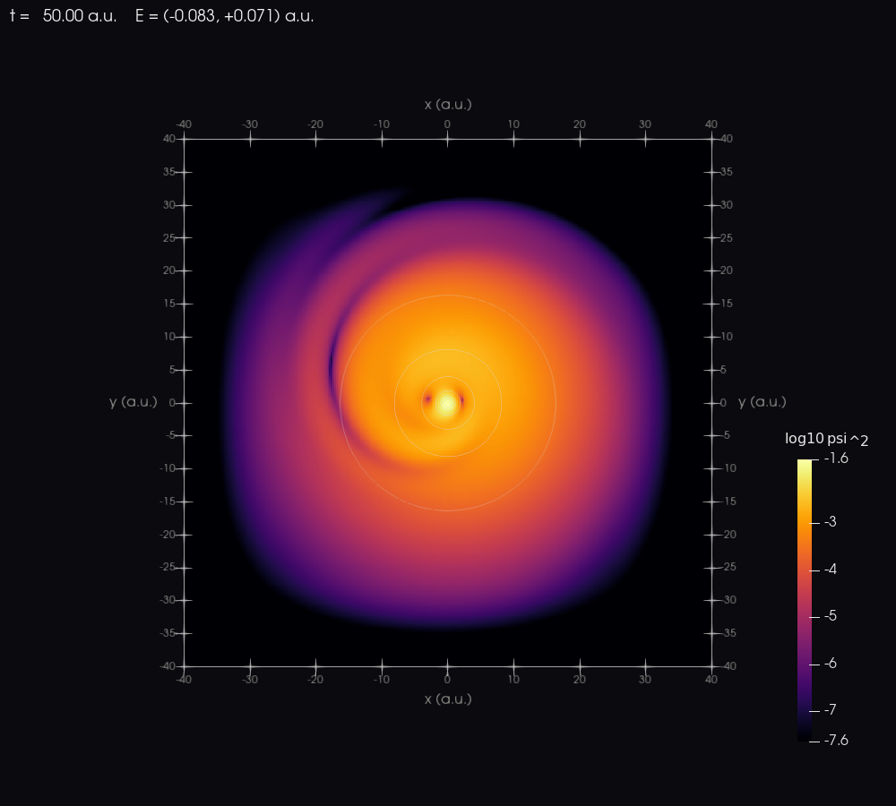
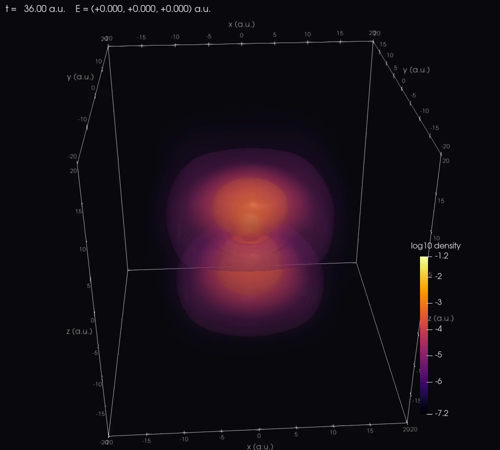

Visualization
=============

zkit provides matplotlib-based visualization for wavefunctions and transition
dipole data.

Wavefunction plots
------------------

.. code-block:: python

   from zkit.viz import plot_wavefunction

   path = plot_wavefunction(
       "td/h2p_wfs.h5",
       step=0,
       outdir="figures",
       npoints=240,
       dpi=150,
       axes=None,
       vtk="figures/wfs.vts",
   )
   print(path)

Dispatch by dimension:

- 1D — stacked ``Re/Im ψ`` and ``|ψ|^2``
- 2D — ``|ψ|^2``, ``Re ψ``, and phase panels
- 3D — ``|ψ|^2`` on the ``z = z_mid`` slice

ParaView and VisIt: images and movies
-------------------------------------

``zkit vtk`` evaluates the B-spline states and wavefunction snapshots of a run
on a uniform grid and writes VTK XML image data (``.vti``, zlib-compressed),
which both ParaView and VisIt open. A time series also gets a ``.pvd``
(ParaView) and a ``.visit`` (VisIt) file. Each snapshot carries its time
(t = k · ``OutputStrideWFS`` · ``TimeStep``) and the laser field at that time
as field data (``TIME``, ``TimeValue``, ``CYCLE``, ``E_x``, ``E_y``, ``E_z``),
so both programs animate in physical time. ``zkit render`` drives ParaView's
``pvpython`` to make publication images and MP4 movies.

.. code-block:: bash

   # export (vtk/<name>_state<i>.vti, vtk/<name>_wfs_<k>.vti, .pvd, .visit)
   zkit --run-dir run/ vtk circ2d.inp
   # export and render everything: state images and the movie
   zkit --run-dir run/ vtk circ2d.inp --render --size 1280 1024
   # render one file or a series, with options
   zkit render run/vtk/circ2d_wfs.pvd --out circ2d.mp4 --decades 6 --fps 20
   zkit render run/vtk/lin3d_wfs.pvd --orbit --iso 1,2.5,4

Arrays (``--fields``): ``density`` :math:`|\psi|^2`, ``log10_density``
(floored at :math:`10^{-8}` of the snapshot maximum) and ``potential``
(:math:`sV`, the carrier's energy; :math:`V_{\rm KH}` for ``Mode = kh``) by
default; ``--fields all`` adds ``re``, ``im`` and ``phase``. Options:
``--npoints`` (grid points per axis, default 160), ``--every`` (snapshot
stride), ``--states 0,1``, ``--no-states``, ``--no-evolution``.

The renderer:

* **2D**: ``log10_density`` over ``--decades`` decades (fixed over the whole
  series), potential contour lines, time and field in the corner, axes in a.u.
* **3D**: volume rendering of ``log10_density`` plus isosurfaces at ``--iso``
  decades below the maximum, optional camera orbit (``--orbit``).

It writes ``<name>_render.py`` next to the frames: a plain ``pvpython``
script to adjust (colours, camera) and rerun. Frames are joined into an MP4 by
ffmpeg when it is on ``PATH``. ``pvpython`` is found on ``PATH``, through
``PVPYTHON`` or ``PARAVIEW_HOME``, or in ``/Applications/ParaView*.app``.

   2D soft-core atom in a circularly polarised pulse (snapshot at t = 50 a.u.).

   3D, linear field along z: volume rendering and isosurfaces.

**VisIt.** Open ``<name>_wfs.visit`` (File > Open); the time slider shows
the physical time from the ``TIME`` field data. Pseudocolor on
``log10_density`` for 2D; Volume or Contour for 3D.

**Python.**

.. code-block:: python

   import zkit
   from zkit.viz.vtk import export_states, export_evolution
   from zkit.viz.paraview import render

   run = zkit.Run("run/", "circ2d.inp")
   export_states(run, "vtk", npoints=200)
   pvd = export_evolution(run, "vtk", every=2, fields="all")
   render(pvd, "circ2d.mp4", decades=6)

The evaluation contracts the coefficients with per-axis B-spline basis
matrices (about 2 ms per 2D snapshot) and equals the igakit reconstruction of
:func:`zkit.io.wfs_field.reconstruct_wfs` to rounding.

Transition-dipole diagrams
--------------------------

.. code-block:: python

   from zkit.viz import plot_transition_diagram

   plot_transition_diagram(
       "static/h2p_eigen.h5",
       outfile="figures/tdm_diagram.png",
       axes="x",
       min_mu=1e-3,
       color_by="strength",
       dpi=150,
   )

.. code-block:: python

   from zkit.viz.tdm import plot_tdm_matrix

   plot_tdm_matrix(
       "static/h2p_eigen.h5",
       outfile="figures/tdm_matrix.png",
       axes=["x", "z"],
       dpi=150,
   )

.. code-block:: python

   from zkit.viz import plot_tdm

   out = plot_tdm(
       "static/h2p_eigen.h5",
       outdir="figures",
       axes=["x", "z"],
       min_mu=1e-3,
       color_by="strength",
       prefix="h2p",
       dpi=150,
   )

Batch plotting
--------------

.. code-block:: python

   from pathlib import Path
   from zkit.viz import plot_wavefunction

   run_dir = Path("/data/run01")
   td_dir = run_dir / "td"
   out_dir = run_dir / "figures"
   out_dir.mkdir(exist_ok=True)

   for path in sorted(td_dir.glob("*_wfs.h5")):
       plot_wavefunction(path, step=0, outdir=out_dir, npoints=200, dpi=150)
